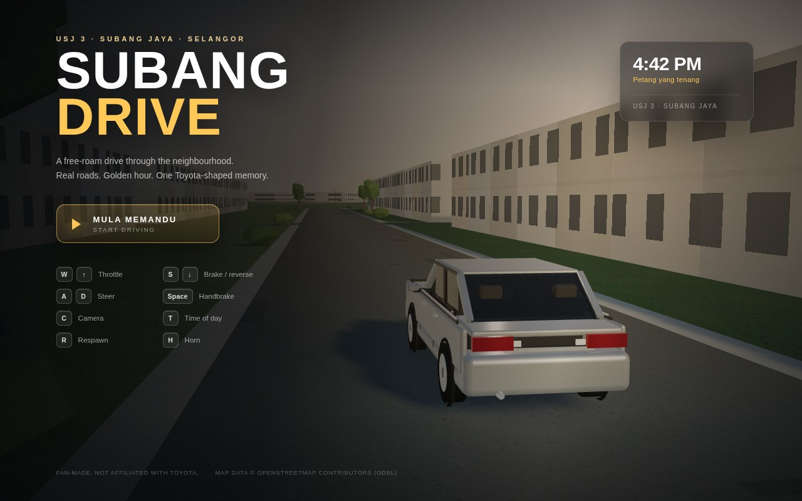
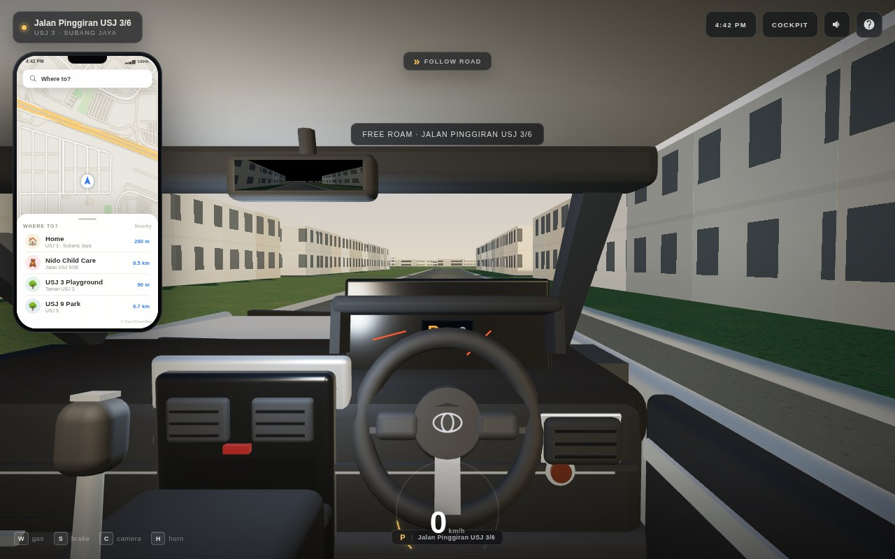
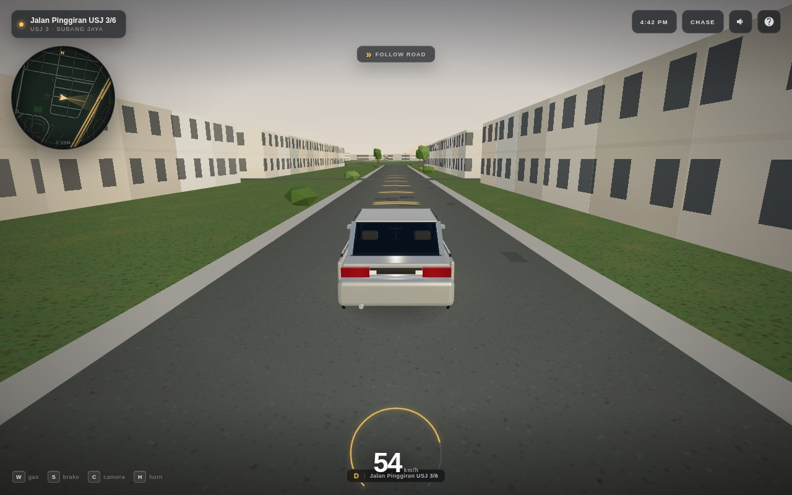
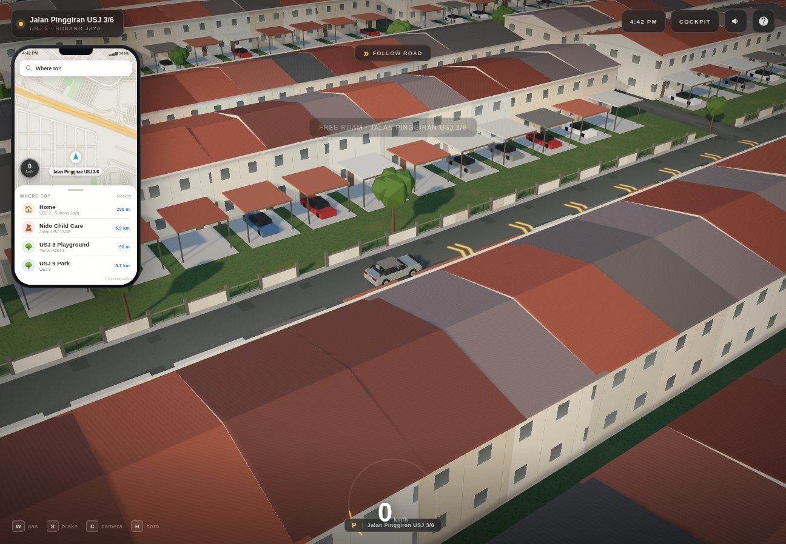
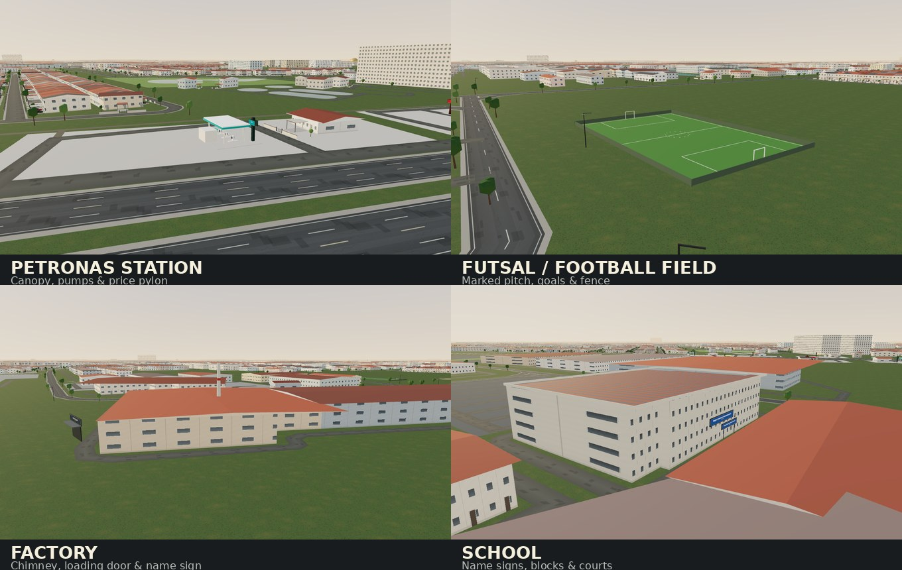
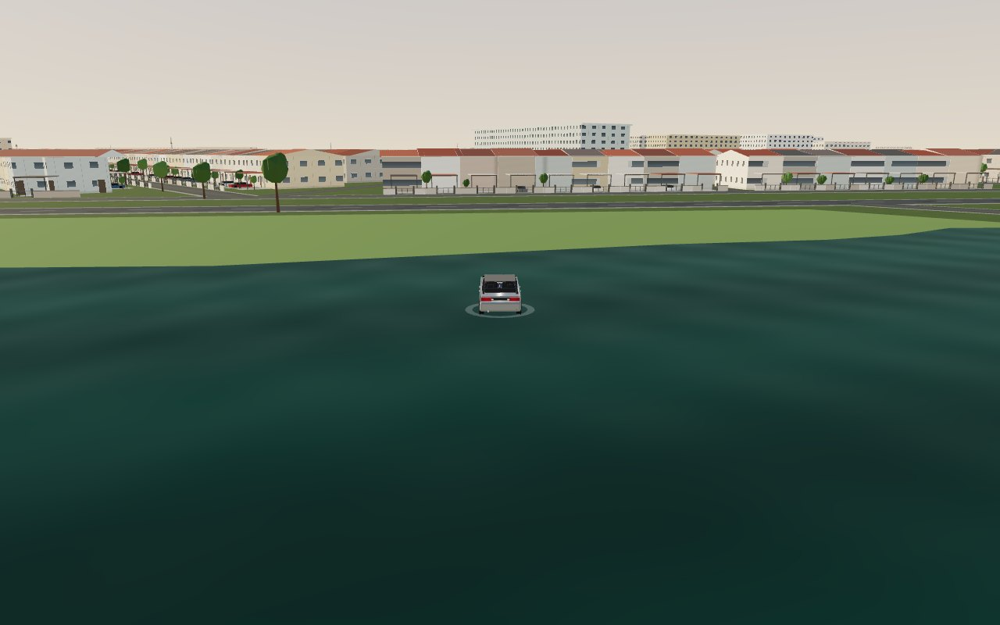
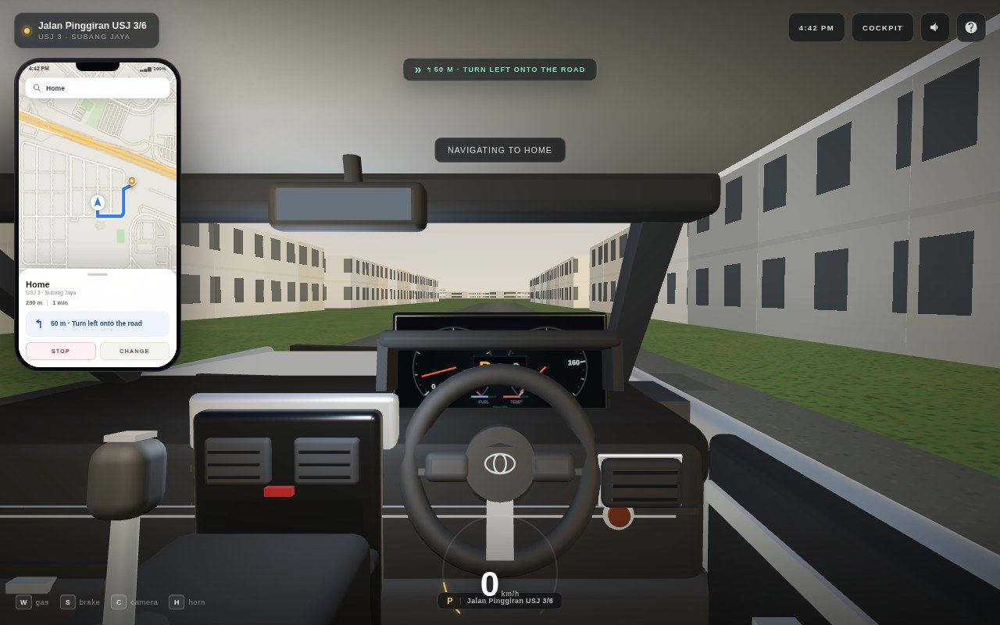
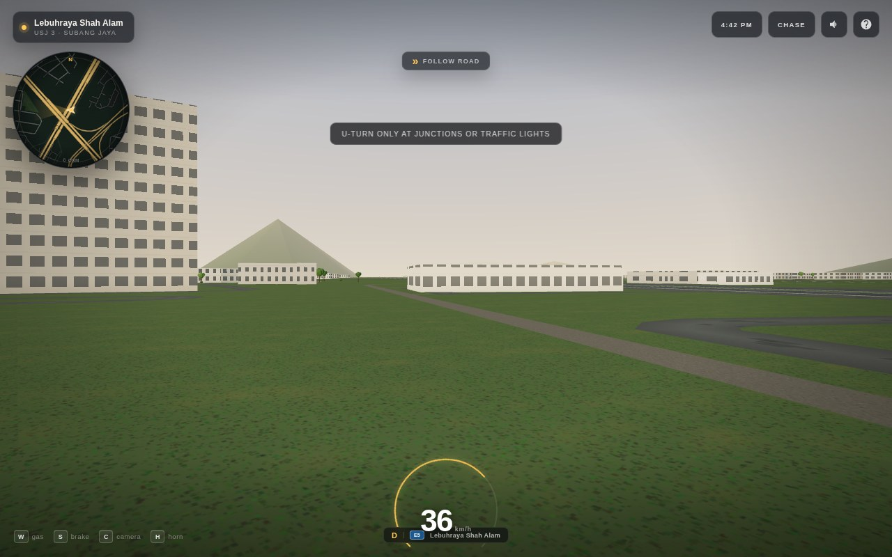
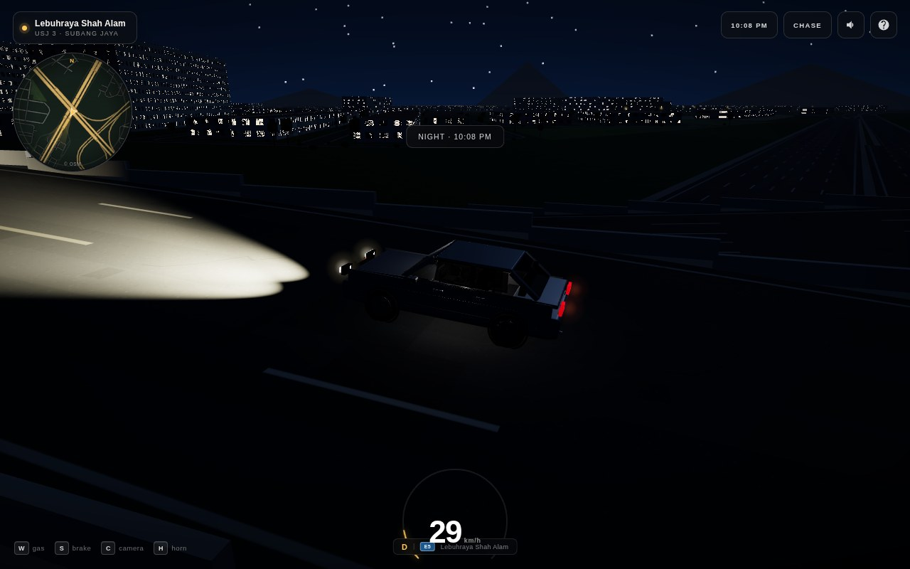

# Subang Drive

**Live:** <https://subang-drive-usj3.onrender.com>

A free-roam 3D driving game set in **USJ 3, Subang Jaya, Selangor** — built around the Google Maps pin at `3.0448217, 101.5589111`.

Drive real OpenStreetMap roads, past actual building footprints, in a right-hand-drive cockpit inspired by the **2014 Toyota Vios**. Golden hour, sunset and night; touch controls for iPad and Android; works offline after the first load.



















---

## Play it

### On your computer

```bash
npm install
npm run dev
```

Open the printed **Local** URL (normally <http://localhost:5173>).

### On iPad / Android

1. Put the tablet and computer on the same Wi-Fi.
2. Run `npm run dev`.
3. On the tablet, open the printed **Network** URL (e.g. `http://192.168.68.107:5173/`) in Safari or Chrome.
4. Turn the device to **landscape**, then tap **MULA MEMANDU**.

For a production build (faster, installable, offline-capable):

```bash
npm run build
npm run preview
```

Open the printed Network URL. On iPad use **Share → Add to Home Screen**; on Android use **Chrome menu → Install app**. After the first visit the game is cached and will start without a network.

> The game is a web app — it cannot be opened by double-clicking `index.html` because it needs a local server (Vite) to load modules and map data.

> **Prefer everything flat?** Add `?flat` to the URL (for example `http://192.168.68.107:4173/?flat`). That disables the raised flyovers and puts every road on one level. The default build uses the real OSM bridge/layer data, so E5/KESAS flies over E6/ELITE.

---

## Controls

| Keyboard | Touch | Action |
|---|---|---|
| `W` / `↑` | GAS pedal | Throttle |
| `S` / `↓` | BRAKE pedal | Brake / reverse |
| `A` `D` / `←` `→` | ◀ ▶ pads | Steer |
| `Space` | `HB` | Handbrake |
| `C` | `CAM` | Cockpit → chase → hood camera |
| `T` | time chip | Golden hour → sunset → night |
| `R` | pause menu | Respawn |
| `M` | speaker icon | Mute |
| `H` | — | Horn |
| `Esc` / `P` | `?` button | Pause / help |
| Mouse drag | drag view | Look around |

The cockpit free-look gently recenters when you let go. Night switches on the headlights, taillights, street lamps and lit windows.

### Phone navigation

- Tap the **phone map** destinations: Home (the original Google Maps pin), **Nido Child Care** (Jalan USJ 13/4E), USJ 3 Playground and USJ 9 Park.
- The map is heading-up; the blue line is a real road-network route, not a straight line. It shows distance, ETA and the next turn, and reroutes if you leave the route.
- **STOP** ends guidance; **CHANGE** goes back to the destination picker.
- The destinations live in `src/game/destinations.js` — edit `home` if your actual home is a different point.

### Road guide & turn rules

- Amber chevrons follow the current lane and a top-centre chip shows **FOLLOW ROAD**.
- The bottom strip carries the **live road name** and a route badge (`E5`, `E6`, …).
- A **U-turn** is only unlocked at a road junction with a left/right side road or at a traffic light. The guide chip changes to **JUNCTION · U-TURN ALLOWED** / **TRAFFIC LIGHT · U-TURN ALLOWED** there.
- On an open straight, trying to swing around is resisted and a notice appears — drive to the next junction or signal to turn around.
- The car still steers normally along bends and can change lanes.

---

## What's in the game

- **A 5× larger neighbourhood** — about 99 km² of playable data (a 7.2 × 7.2 km target box; complete OSM ways extend the visible/playable bounds to roughly 10 × 10 km), with 9,300+ road segments, 48,000+ buildings, 1,200+ land-use areas, footpaths, 171 traffic lights, 188 bus stops and 11,800+ junctions, baked from OpenStreetMap.
- **USJ 3 streetscape** — real OSM footprints now carry pitched tiled roofs, shophouse awnings and signboards, low front walls with metal gates, car-porch canopies, driveways, parked Malaysian compact cars and leafy front gardens. Facades use framed windows, front doors, floor bands and concrete plinths, so the two-storey terraces read like the actual neighbourhood instead of generic blocks. Details are concentrated around the start area and thin out with distance for performance.
- **Real OSM landmarks** — petrol stations are modelled with branded canopies, pumps, a shop, forecourt and price pylon; schools get gate/facade name signs and sports courts; factories have chimneys, silos, loading doors and entrance signs; football/futsal fields get turf, markings, goals and fencing; mosques get domes and minarets; supermarkets and restaurants get shophouse signage. The nearest ones to the start are a Petronas station, a futsal field, a factory, a school and a mosque.
- **Animated water** — lakes, ponds, basins, swimming pools, rivers, streams, canals and drains use a moving water shader with ripples, sky reflection, sun glints and night darkening. Deep water slows the car and leaves an expanding wake; bridge decks stay above the water.
- **Open roofs are actually open** — OSM `building=roof` structures such as LRT station canopies, bus-station roofs and petrol canopies no longer act as solid collision walls across the road. Traffic-signal poles are also placed on the verge instead of in the traffic lane. Collision is height-aware and ignores structures whose footprint covers a road, so driving on a flyover no longer hits the roofs below, and ground traffic does not hit overhead station/bridge structures.
- **Real OSM bridge/layer data** — the E5 (KESAS) flyover now passes over the E6 (ELITE) carriageway on a raised deck with parapets and piers, while ordinary junctions and residential streets are flat. The minimap carries E5/E6 route badges. Bridge height only follows a deck when you are on that bridge road and heading along it, so traffic crossing underneath stays at ground level instead of being lifted onto the flyover and dropped again. Flyovers ramp up and back down at both ends, with solid side fascia and a concrete underside instead of a floating black half-deck.
- **Owner’s Vios-inspired RHD cockpit** — a 2014 Vios-style dash with an aftermarket Android head unit (live speed, gear, car graphic and app tiles), pink dash-mat piping, silver wheel V-trim, twin-dial Optitron-style cluster with working needles and gear display, automatic shifter, handbrake, seats with headrests, door cards, light headliner and a working rear-view mirror (a live render of the road behind).
- **Real driving feel** — arcade handling with speed-sensitive steering, automatic gears, engine/tyre audio synthesised with Web Audio, body roll, off-road drag, building collisions, handbrake slides and impact shake.
- **Three cameras** — cockpit, chase and hood.
- **Living light** — golden hour, sunset and night, with real-time shadows, street-lamp glow, lit windows, headlight cones and a starry sky.
- **Waze-style phone navigation** — a phone-shaped map with heading-up tracking, black turn banner, purple route line, current-road pill, traffic-light markers, speed bubble, destination picker (**Home, Nido Child Care, USJ 3 Playground, USJ 9 Park**), ETA/distance and next-turn instructions. The phone also has STOP / CHANGE and an OpenStreetMap credit. Routing respects one-way carriageways, picks the correct side of a dual carriageway from the car’s heading, and snaps to the road edge instead of a node behind the car, so it no longer backtracks or zigzags at crossings such as the 286/E5 interchange.
- **Road guide & HUD** — amber lane-guide chevrons when not navigating, a FOLLOW ROAD / JUNCTION / next-turn chip, speed, gear, RPM arc, and a live road-name plate with a route badge at the bottom of the screen.
- **Tablet / phone ready** — responsive HUD, large multi-touch pedals and steering pads, safe-area awareness, portrait rotate prompt, installable PWA, automatic quality scaling if the frame rate drops.

---

## Project layout

```
scripts/build-map.mjs      download + convert OSM data to public/data/subang-jaya.json
public/data/               baked map (roads, buildings, land use, trees, signals)
public/manifest.webmanifest, sw.js, icons/
src/main.js                game boot, lighting, cameras, loop
src/world/world.js         roads, buildings, land, trees, street lamps, collision
src/world/sky.js           sky shader, day/sunset/night presets, PMREM environment
src/world/textures.js      procedural asphalt, grass, cluster, radio, plates, icons
src/car/physics.js         arcade car model
src/car/exterior.js        stylised Vios body, wheels and lights
src/car/interior.js        RHD cockpit, dashboard, cluster, mirror, seats, console
src/game/input.js          keyboard + multi-touch + free-look
src/game/hud.js             DOM HUD
src/game/minimap.js         pre-rendered OSM minimap
src/game/audio.js           procedural engine / tyre / horn synth
docs/                       screenshots
```

### Rebuilding the map

The map snapshot is already included, so the game needs no network at runtime. To refresh it:

```bash
npm run map           # use scripts/.cache/usj.osm if present
npm run map:refresh   # download a fresh extract from the OSM API
```

The build downloads a 3 × 3 grid of OSM API tiles covering a 7.2 × 7.2 km box around the pin (about `101.5265,3.0123 → 101.5913,3.0774`), then merges and de-duplicates the tiles. Complete ways extending beyond that box make the final data bounds roughly 10 × 10 km. The origin is the pin above; the game uses metres and `-Z = north`.

---

## Performance

The larger map has 48k buildings and loads in roughly 10 seconds on a modern machine (a little longer on tablets). Buildings are split into 1.2 km chunks and distance/frustum-culled, so only the nearby city is drawn. The game starts at a reduced pixel ratio and 1024² shadows on touch devices; if the average frame rate stays below ~27 fps it automatically drops shadows, the live mirror and resolution. Close other tabs and use landscape for the best result.

---

## Credits & notes

- **Map data © OpenStreetMap contributors**, licensed under the [Open Database License (ODbL 1.0)](https://www.openstreetmap.org/copyright). The map was converted from 3 × 3 OSM API tiles by `scripts/build-map.mjs`.
- Built with [Three.js](https://threejs.org/) (MIT) and [Vite](https://vitejs.dev/) (MIT).
- This is a **fan-made, non-commercial project**. It is not affiliated with, endorsed by, or licensed by Toyota. “Toyota” and “Vios” are trademarks of Toyota Motor Corporation; the cockpit is a stylised tribute, not a licensed 3D model.
- The vehicle handling, traffic (there is none), and city details are simplified for playability. Roads and buildings are as mapped in OpenStreetMap at the time the snapshot was generated.

---

## Deploying

The repo is deployed as a **Render Static Site** using the included `render.yaml` (Blueprint-managed, auto-deploy on every push to `main`).

- Live: <https://subang-drive-usj3.onrender.com>
- GitHub: <https://github.com/ngjingtao/subang-drive>
- Build: `npm ci && npm run build`
- Publish: `dist`
- SPA rewrite to `index.html`
- No-cache for `sw.js`, immutable caching for hashed assets
- The 9.8 MB map is committed in `public/data/`, so Render does not call OpenStreetMap during a deploy.

To redeploy manually: **Render → Blueprint → subang-drive → Manual sync**, or push another commit to `main`.

[](https://render.com/deploy?repo=https://github.com/ngjingtao/subang-drive)

The service worker is production-only (it is registered when `import.meta.env.PROD` is true), so the deployed site is installable as a PWA and works offline after the first visit.
